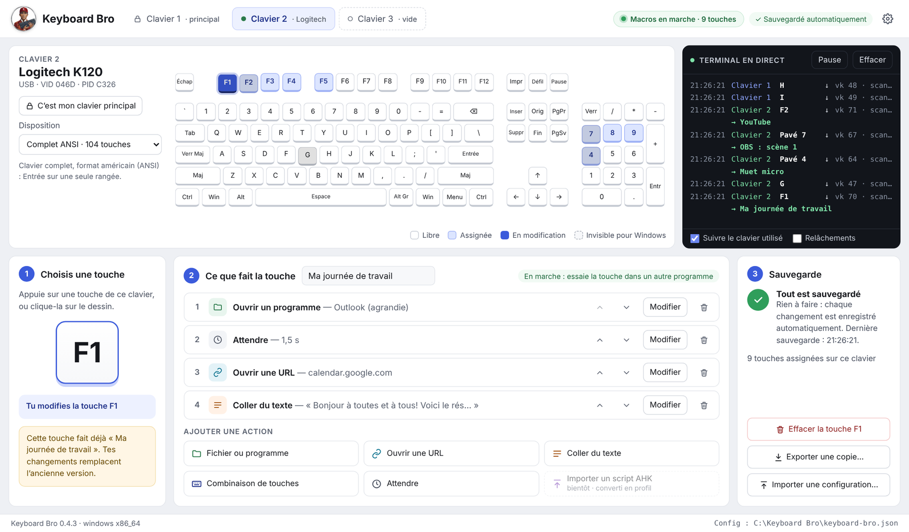

<p align="center">
  
</p>

<h1 align="center">Keyboard Bro</h1>

<p align="center">
  <strong>A second keyboard for your macros.</strong><br>
  Plug in an old keyboard (or a numeric keypad) and give every key an action:<br>
  open a program or a website, paste text, press a shortcut… or all of it at once.
</p>

<p align="center">
  <a href="README.md">Français</a> · <strong>English</strong>
</p>

<p align="center">
  <a href="https://github.com/jarvis-ai-intel/keyboard-bro/actions/workflows/fabriquer.yml"></a>
  
  
  
  
  
</p>

<p align="center">
  
</p>

> 🌍 **The interface is available in English, French, Spanish and Bulgarian.** Pick the language in ⚙ Settings (by default, it follows your computer). The screenshot above is in French.

---

## What is it?

You probably have a spare keyboard in a drawer. **Keyboard Bro turns it into a macro keyboard**, like a Stream Deck, but with a keyboard you already own.

- Your **main keyboard stays normal**: you type as usual.
- On the **second keyboard**, each programmed key does **what you chose**, and only that. If F1 opens your e-mail, it no longer acts as "F1".
- Keys you don't program keep working normally.

The hard part is that Windows sees all keyboards as one: it doesn't say which keyboard a key came from. Keyboard Bro **tells each keyboard apart**, with no driver to install and no administrator rights.

## What you can do with it

| For… | Example key |
|---|---|
| **Office work** | "My day": opens Outlook, waits 2 seconds, opens your calendar, pastes your morning message with today's date. |
| **Repeated text** | Your signature, your address, a canned reply, a file number. |
| **Streaming** | Switch OBS scenes, mute the mic, start music (Keyboard Bro sends the shortcut OBS listens to). |
| **Programs** | Calculator, Notepad, Photoshop, a folder, a specific Excel file… |
| **The web** | Open a site in the browser of your choice, even in private mode. |
| **Awkward shortcuts** | Screenshot (Win + Shift + S), Ctrl + Alt + something, media keys… |

## How it works: 3 steps

1. **Pick a key**: press it on your second keyboard, or click it on the drawing.
2. **Say what the key does**: add one or more actions, in any order:
   - 📁 **Open a file or program** (normal, maximized or minimized window)
   - 🔗 **Open a URL** (default browser or another one, private mode available)
   - 📝 **Paste text**, with automatic values: `{date}`, `{time}`, `{clipboard}`, `{cursor}` (cursor position)
   - ⌨️ **Key combination** (Ctrl, Alt, Shift, Win, F1 to F24, arrows, media keys…)
   - ⏱️ **Wait** a fixed time, or until a window opens
3. **That's it**: it saves automatically. Go to any other program and press the key.

## Features

- 🌍 **In English, French, Spanish and Bulgarian**: choose the language in ⚙ Settings (by default, your computer's language).
- 🎹 **One tab per keyboard**, with its name, maker and a **drawing of its keys** (12 layouts: full size, compact, tenkeyless, ISO Canadian French, Apple with F13 to F19, numeric keypad…).
- 🖥️ **Live terminal**: every key pressed, which keyboard it came from, and which macro ran.
- 🔒 **Main keyboard locked**: Keyboard Bro never touches its keys (unless you allow it, e.g. for F13 to F19).
- ⏯️ **"Macros on" button**: one click and your second keyboard is a normal keyboard again.
- 🚀 **Start with Windows** (⚙ settings button), minimized if you like.
- 💾 **Automatic saving** to a `keyboard-bro.json` file, with export and import.
- 🎮 **Logitech G710 / G710+**: G1 to G6 keys, M1/M2/M3 banks and MR, without Logitech's software.
- 🔊 **Media keys** (volume, play, next track…) recognized on every keyboard.
- 🖱️ Mice that pretend to be keyboards are **set aside** automatically.

## Download and install

> Test builds are in the **[Actions](https://github.com/jarvis-ai-intel/keyboard-bro/actions)** tab. An official download page ("Releases") is coming soon.

1. Open the **[Actions](https://github.com/jarvis-ai-intel/keyboard-bro/actions)** tab and click the latest run with a green ✓.
2. At the bottom of the page, under **Artifacts**, take the file you need (you must be signed in to GitHub):

| File | For |
|---|---|
| `KeyboardBro-<version>-Windows-x64` | most Windows 10 and 11 PCs |
| `KeyboardBro-<version>-Windows-ARM64` | Windows PCs with an ARM chip (Snapdragon, Surface Pro X…) |
| `KeyboardBro-<version>-Mac-puces-Apple` | M1 to M4 Macs (demo mode for now) |

3. Open the `.zip`. For Windows you can choose:
   - **`…-portable-….exe`**: nothing to install, no administrator rights. Put it in a folder of your own: its settings file stays next to it;
   - **`…-installateur-….exe`**: a regular installer, with a Start menu shortcut.

**Windows says "Windows protected your PC"?** That's normal for a new program without a (costly) digital signature yet. Click **More info**, then **Run anyway**.

**On Mac:** drag Keyboard Bro into your **Applications** folder. The first time, **right-click › Open** (the app isn't signed by Apple yet).

## Security and privacy

- ✅ **Nothing is sent over the Internet.** No account, no ads, no analytics.
- ✅ **No driver, no administrator rights.**
- ✅ **Nothing you type on your main keyboard is recorded.** The terminal shows keys live, but doesn't keep them.
- ✅ Your settings are a plain text file (`keyboard-bro.json`) **on your computer**.
- ✅ **The code is public**: everything the program does is visible in this repository.

## Good to know

- **Macros don't run while Keyboard Bro is the active window**, so you can choose and test your keys in peace. Click into another program, then press the key.
- To hide programmed keys from other programs, Keyboard Bro uses a small DLL (`kbhook`, in this repository) that Windows loads into programs receiving keyboard input. **Some corporate antivirus tools may block it.** Macros still run, but the key also does its normal job (the top button turns orange).
- **Known limits:**
  - programs running **as administrator** still see the key;
  - the **Windows key** and **media keys** can't be hidden;
  - "Paste text" restores your clipboard afterwards. If it held an image, the text is typed instead, so the image isn't lost.
- If you move the portable version, open it once in its new place: "start with Windows" updates itself.

## Why Keyboard Bro?

There are other ways to use a second keyboard, but they often mean writing code, installing a driver or paying.

| | Keyboard Bro | AutoHotkey alone | AutoHotInterception | Stream Deck |
|---|:-:|:-:|:-:|:-:|
| Tells the 2nd keyboard apart | ✅ | ❌ | ✅ | — |
| No code to write | ✅ | ❌ | ❌ | ✅ |
| No driver or admin rights | ✅ | ✅ | ❌ | ❌ |
| Uses a keyboard you already own | ✅ | ✅ | ✅ | ❌ |
| Free | ✅ | ✅ | ✅ | ❌ |

## Roadmap

- ✅ **0.1**: one tab per keyboard, keyboard drawing, live terminal
- ✅ **0.2**: steps 1-2-3, action windows, automatic saving, export and import, locked main keyboard
- ✅ **0.3**: Logitech G710 / G710+, media keys, mice set aside
- ✅ **0.4**: macros work (actions + hidden keys), start with Windows, new logo
- ✅ **0.5**: interface in English, French, Spanish and Bulgarian
- ⏳ Profiles (one set of keys per program: Photoshop, OBS, Excel…)
- ⏳ Import an AutoHotkey script (`.ahk`) and convert it to a profile
- ⏳ Printable labels to stick on the keys
- ⏳ Full Mac version, then Linux
- ⏳ AI connection (MCP): let an assistant like Claude build your macros for you

## For developers

- **Core:** Rust (`src-tauri/`), with [Tauri 2](https://tauri.app) for the window.
- **Interface:** HTML, CSS and JavaScript with no dependencies (`ui/`).
- **Reading keyboards on Windows:** Raw Input (`src-tauri/src/input/windows.rs`).
- **Hiding programmed keys:** `kbhook/` (DLL built by `src-tauri/build.rs` and embedded in the .exe).
- **Macro actions:** `src-tauri/src/macros/`. **Start with the system:** `src-tauri/src/autostart.rs`.
- **Builds:** GitHub Actions (`.github/workflows/fabriquer.yml`) compiles Windows x64, Windows ARM64 and Mac on every push.

To build it yourself you need [Rust](https://rustup.rs) and [Node.js](https://nodejs.org):

```
npm install
npx tauri dev      # run in development mode
npx tauri build    # build the final version
```

<p align="center"><sub>Made in Québec with ❤️ and a lot of keyboards.</sub></p>
