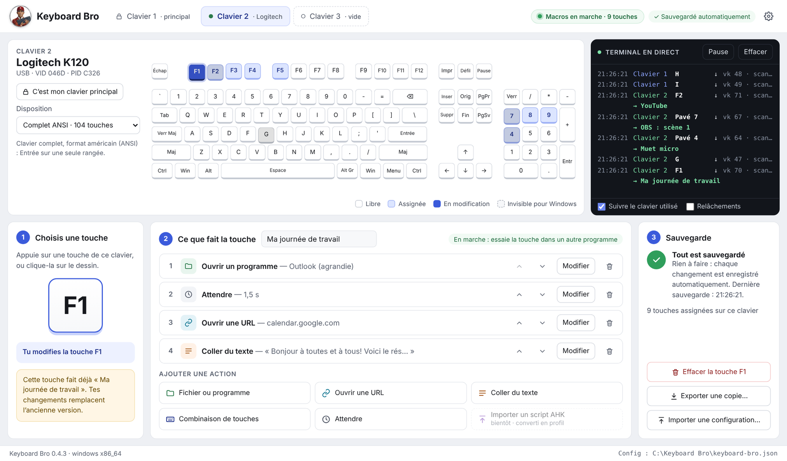
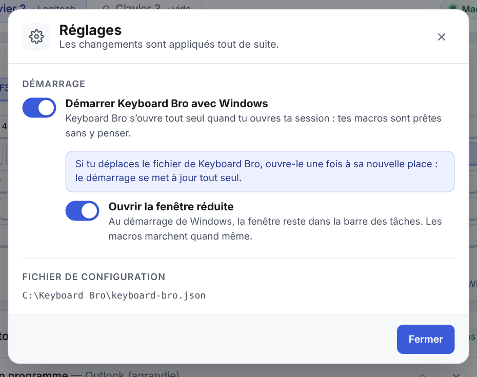

<p align="center">
  
</p>

<h1 align="center">Keyboard Bro</h1>

<p align="center">
  <strong>Un 2e clavier pour tes macros.</strong><br>
  Branche un vieux clavier (ou un pavé numérique) et donne à chaque touche une action :<br>
  ouvrir un programme, un site, coller du texte, faire un raccourci… ou tout ça d'un coup.
</p>

<p align="center">
  <strong>Français</strong> · <a href="README.en.md">English</a>
</p>

<p align="center">
  <a href="https://github.com/jarvis-ai-intel/keyboard-bro/actions/workflows/fabriquer.yml"></a>
  
  
  
  
</p>

<p align="center">
  
</p>

---

## C'est quoi?

Tu as sûrement un clavier qui traîne dans un tiroir. **Keyboard Bro le transforme en clavier à macros**, comme un Stream Deck, mais avec un clavier que tu as déjà.

- Ton **clavier principal reste normal** : tu écris comme d'habitude.
- Sur le **deuxième clavier**, chaque touche programmée fait **ce que tu as choisi**, et seulement ça. Si F1 ouvre ta boîte courriel, elle ne fait plus « F1 ».
- Les touches que tu ne programmes pas continuent de marcher normalement.

Le plus difficile, c'est que Windows voit tous les claviers comme un seul : il ne dit pas de quel clavier vient une touche. Keyboard Bro, lui, **reconnaît chaque clavier séparément**, sans pilote à installer et sans droits d'administrateur.

## Ce que tu peux en faire

| Pour… | Exemple de touche |
|---|---|
| **Le bureau** | « Ma journée » : ouvre Outlook, attend 2 secondes, ouvre ton calendrier, colle ton message du matin avec la date du jour. |
| **Le texte répété** | Ta signature, ton adresse, une réponse type, un numéro de dossier. |
| **Le streaming** | Changer de scène dans OBS, couper le micro, lancer une musique (Keyboard Bro envoie le raccourci qu'OBS écoute). |
| **Les programmes** | Calculatrice, Bloc-notes, Photoshop, un dossier, un fichier Excel précis… |
| **Le Web** | Ouvrir un site dans le navigateur de ton choix, même en navigation privée. |
| **Les raccourcis compliqués** | Capture d'écran (Win + Maj + S), Ctrl + Alt + quelque chose, touches multimédia… |

## Comment ça marche : 3 étapes

1. **Choisis une touche** : appuie dessus sur ton 2e clavier, ou clique-la sur le dessin.
2. **Dis ce qu'elle fait** : ajoute une ou plusieurs actions, dans l'ordre que tu veux :
   - 📁 **Ouvrir un fichier ou un programme** (fenêtre normale, agrandie ou réduite)
   - 🔗 **Ouvrir une URL** (navigateur par défaut ou un autre, navigation privée possible)
   - 📝 **Coller du texte**, avec des variables : `{date}`, `{heure}`, `{presse-papiers}`, `{curseur}`
   - ⌨️ **Combinaison de touches** (Ctrl, Alt, Maj, Win, F1 à F24, flèches, multimédia…)
   - ⏱️ **Attendre** un temps fixe, ou qu'une fenêtre s'ouvre
3. **C'est tout** : c'est sauvegardé automatiquement. Va dans n'importe quel autre programme et appuie sur la touche.

## Fonctionnalités

- 🎹 **Un onglet par clavier**, avec son nom, son fabricant et un **dessin de ses touches** (12 dispositions : complet, compact, sans pavé numérique, ISO canadien français, Apple avec F13 à F19, pavé numérique seul…).
- 🖥️ **Terminal en direct** : chaque touche appuyée, de quel clavier elle vient, et quelle macro est partie.
- 🔒 **Clavier principal verrouillé** : Keyboard Bro ne touche jamais à ses touches (sauf si tu le permets, par exemple pour F13 à F19).
- ⏯️ **Bouton « Macros en marche »** : un clic et ton 2e clavier redevient un clavier normal.
- 🚀 **Démarrer avec Windows** (bouton ⚙ Réglages), fenêtre réduite si tu veux.
- 💾 **Sauvegarde automatique** dans un fichier `keyboard-bro.json`, avec export et import d'une copie.
- 🎮 **Logitech G710 / G710+** : touches G1 à G6, banques M1/M2/M3 et MR, sans le logiciel de Logitech.
- 🔊 **Touches multimédia** (volume, lecture, piste suivante…) reconnues sur tous les claviers.
- 🖱️ Les souris qui se font passer pour des claviers sont **mises de côté** toutes seules.

<p align="center">
  
</p>

## Télécharger et installer

> Les versions de test sont dans l'onglet **[Actions](https://github.com/jarvis-ai-intel/keyboard-bro/actions)**. Une page de téléchargement officielle (« Releases ») arrive bientôt.

1. Ouvre l'onglet **[Actions](https://github.com/jarvis-ai-intel/keyboard-bro/actions)** et clique sur la dernière fabrication avec un ✓ vert.
2. En bas de la page, dans **Artifacts**, prends le fichier qu'il te faut (il faut être connecté à un compte GitHub) :

| Fichier | Pour qui |
|---|---|
| `KeyboardBro-<version>-Windows-x64` | la plupart des PC Windows 10 et 11 |
| `KeyboardBro-<version>-Windows-ARM64` | PC Windows à puce ARM (Snapdragon, Surface Pro X…) |
| `KeyboardBro-<version>-Mac-puces-Apple` | Mac M1 à M4 (mode démonstration pour l'instant) |

3. Ouvre le `.zip`. Pour Windows, tu as le choix entre :
   - **`…-portable-….exe`** : rien à installer, aucun droit d'administrateur. Mets-le dans un dossier à toi, et sa configuration reste à côté de lui;
   - **`…-installateur-….exe`** : installation classique, avec un raccourci dans le menu Démarrer.

**Windows affiche « Windows a protégé votre ordinateur »?** C'est normal pour un nouveau programme qui n'a pas encore de signature numérique (elle coûte cher). Clique sur **Informations complémentaires**, puis sur **Exécuter quand même**.

**Sur Mac :** glisse Keyboard Bro dans le dossier **Applications**. La 1re fois, fais un **clic droit › Ouvrir** (l'application n'est pas encore signée par Apple).

## Sécurité et vie privée

- ✅ **Rien n'est envoyé sur Internet.** Keyboard Bro n'a pas de compte, pas de publicité et pas de statistiques.
- ✅ **Aucun pilote, aucun droit d'administrateur.**
- ✅ **Rien n'est enregistré de ce que tu tapes** sur ton clavier principal. Le terminal montre les touches en direct, mais ne les garde pas.
- ✅ Ta configuration est un simple fichier texte (`keyboard-bro.json`) **sur ton ordinateur**.
- ✅ **Le code est public** : tout ce que fait le programme est visible dans ce dépôt.

## Bon à savoir

- **Les macros ne partent pas quand Keyboard Bro est la fenêtre active**, pour que tu puisses choisir et essayer tes touches en paix. Clique dans un autre programme, puis appuie sur la touche.
- Pour cacher les touches programmées aux autres programmes, Keyboard Bro utilise un petit fichier DLL (`kbhook`, dans ce dépôt) que Windows charge dans les programmes qui reçoivent le clavier. **Certains antivirus d'entreprise peuvent le bloquer.** Les macros partent quand même, mais la touche fait aussi son travail normal (le bouton en haut devient orange).
- **Limites connues :**
  - les programmes lancés **en administrateur** voient quand même la touche;
  - la **touche Windows** et les **touches multimédia** ne peuvent pas être cachées;
  - « Coller du texte » remet ton presse-papiers comme avant. S'il contenait une image, le texte est tapé à la place, pour ne pas la perdre.
- Si tu déplaces la version portable, ouvre-la une fois à sa nouvelle place : le démarrage avec Windows se met à jour tout seul.

## Pourquoi Keyboard Bro?

Il existe d'autres façons d'utiliser un 2e clavier, mais elles demandent souvent d'écrire du code, d'installer un pilote ou de payer.

| | Keyboard Bro | AutoHotkey seul | AutoHotInterception | Stream Deck |
|---|:-:|:-:|:-:|:-:|
| Reconnaît le 2e clavier | ✅ | ❌ | ✅ | — |
| Sans écrire de code | ✅ | ❌ | ❌ | ✅ |
| Sans pilote ni admin | ✅ | ✅ | ❌ | ❌ |
| Utilise un clavier que tu as déjà | ✅ | ✅ | ✅ | ❌ |
| Gratuit | ✅ | ✅ | ✅ | ❌ |

## Feuille de route

- ✅ **0.1** : onglets par clavier, dessin du clavier, terminal en direct
- ✅ **0.2** : étapes 1-2-3, fenêtres d'actions, sauvegarde automatique, export et import, clavier principal verrouillé
- ✅ **0.3** : Logitech G710 / G710+, touches multimédia, souris mises de côté
- ✅ **0.4** : les macros marchent (actions + touches cachées), démarrer avec Windows, nouveau logo
- ⏳ Profils (un jeu de touches par programme : Photoshop, OBS, Excel…)
- ⏳ Importer un script AutoHotkey (`.ahk`) et le convertir en profil
- ⏳ Étiquettes à imprimer pour coller sur les touches
- ⏳ Version Mac complète, puis Linux
- ⏳ Interface en anglais
- ⏳ Connexion IA (MCP) : laisser un assistant comme Claude créer tes macros pour toi

## Pour les développeurs

- **Cœur :** Rust (`src-tauri/`), avec [Tauri 2](https://tauri.app) pour la fenêtre.
- **Interface :** HTML, CSS et JavaScript sans dépendance (`ui/`).
- **Lecture des claviers sous Windows :** Raw Input (`src-tauri/src/input/windows.rs`).
- **Blocage des touches programmées :** `kbhook/` (DLL fabriqué par `src-tauri/build.rs` et rangé dans le .exe).
- **Actions des macros :** `src-tauri/src/macros/`. **Démarrage avec le système :** `src-tauri/src/autostart.rs`.
- **Fabrication :** GitHub Actions (`.github/workflows/fabriquer.yml`) compile Windows x64, Windows ARM64 et Mac à chaque envoi de code.

Pour compiler toi-même, il faut [Rust](https://rustup.rs) et [Node.js](https://nodejs.org) :

```
npm install
npx tauri dev      # lancer en mode développement
npx tauri build    # fabriquer la version finale
```

<p align="center"><sub>Fait au Québec avec ❤️ et beaucoup de claviers.</sub></p>
